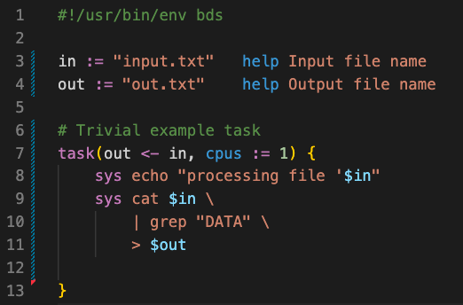

# Syntax highlight 

There are a couple of extensions for syntax highlighting you can use.

- The VIM syntax highlight module for bds can be found [here](https://github.com/serine/bdsSyntaxHighlight)
- The VSCode language extension (syntax highlighting, LSP support, peek definition) can be found in the [bds repository](https://github.com/pcingola/bds/tree/main/vscode/bds)

### Installing VSCode extension

The VSCode extension requires compilation before installation. From the [vscode/bds](https://github.com/pcingola/bds/tree/main/vscode/bds) directory:
```
cd vscode/bds
npm install
npm run compile
cp -rvf . $HOME/.vscode/extensions/bds
```

After re-starting VSCode, bds language support should work when you open any `*.bds` file.


